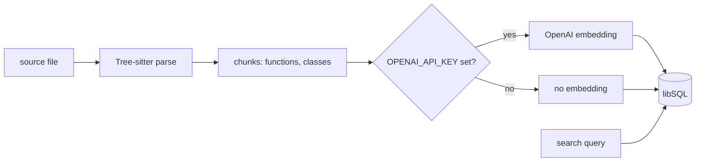

<div align="center">

# `codebase-mcp`

**An MCP server that indexes source files into libSQL and searches them, written for one person's Claude Code setup.**

[](https://github.com/Questi0nM4rk/codebase-mcp/actions/workflows/ci.yml)
[](./LICENSE)

</div>

Not maintained. For real use, try [semble](https://github.com/MinishLab/semble), [graphify](https://github.com/Graphify-Labs/graphify) or [GitNexus](https://github.com/abhigyanpatwari/GitNexus).

```text
index_file(path="src/codebase_rag/server.py", project="demo")
  -> {"chunks_created": <n>, ...}
search(query="compute file hash", k=3, project="demo")
  -> [{"_search_mode": "keyword_only (embeddings unavailable)"}, {"name": "Chunk", "score": 0.5, ...}, ...]
```

## Why it exists

Claude Code reads a codebase with grep and file reads, which costs many round trips on an unfamiliar tree.
This was my try-out of code retrieval for it.
It started as an ambitious design with Qdrant, a Merkle tree for change detection and BM25 with rank fusion.
That was over-engineering for a tool used by one person, and too much to finish properly as a side project.
I cut it down to libSQL, vector search and a keyword fallback, and stopped there, because better implementations now exist (see the top of this page).

## Quickstart

Requires [uv](https://docs.astral.sh/uv/) and Python 3.12. The repo pins 3.12 in `.python-version`, because the libSQL binding crashes on 3.14.

```bash
git clone https://github.com/Questi0nM4rk/codebase-mcp.git && cd codebase-mcp && uv sync --all-extras
```

Run it. This sends an MCP handshake and lists the tools. No API key is needed.

```bash
printf '%s\n' \
  '{"jsonrpc":"2.0","id":1,"method":"initialize","params":{"protocolVersion":"2024-11-05","capabilities":{},"clientInfo":{"name":"t","version":"0"}}}' \
  '{"jsonrpc":"2.0","method":"notifications/initialized"}' \
  '{"jsonrpc":"2.0","id":2,"method":"tools/list"}' \
  | uv run codebase-rag | grep -o '"name":"[a-z_]*"'
```

```text
"name":"search"
"name":"index_file"
"name":"delete_file"
"name":"clear_project"
"name":"status"
```

Test:

```bash
uv run pytest tests/ -v
```

To use it in Claude Code: `claude mcp add codebase -- uv run --directory "$PWD" codebase-rag`.
Set `OPENAI_API_KEY` to get vector search. Without it, search is keyword only.
The index is `~/.codeagent/codeagent.db`. Tools, search modes and settings are in [docs/reference.md](docs/reference.md).

## How it works



Parsing, chunking, hashing and storage are deterministic and run locally.
The only call to a model is the OpenAI embeddings request, and only when a key is set.
Each chunk stores a sha256 of its file. `index_file` does not compare it: it deletes the file's chunks and rebuilds them on every call.
Search is cosine distance over embeddings, or a `LIKE` keyword match without them. There is no BM25 and no rank fusion.

## Numbers

| What | How to measure |
| --- | --- |
| Tests | `uv run pytest tests/ -v` |
| Tests on Python 3.14 | `uv run --python 3.14 --extra dev pytest tests/ -v` |
| Code size | `scc src tests` |
| Index one file, keyless | `index_file` through `CodebaseRAG`, no key, fresh database |
| Search quality | Not measured: no benchmark exists |

Commits include agent-authored work under my identity; design, orchestration and review are mine.

## Status

- **Works:** the stdio MCP server, Tree-sitter chunking for the supported languages, indexing one file at a time, keyword search without a key, ruff and pyright clean.
- **Experimental:** vector search through OpenAI embeddings. It is covered by no test and I did not measure its quality.
- **Tried and dropped:** Qdrant, a Merkle tree and BM25 with rank fusion. The first commit had them. Commit `bdd1fad` migrated to libSQL.
- **Known gaps:**
  - Keyword search ranks nothing: any matching word gives score 0.5.
  - The TypeScript grammar does not load, so `.ts` and `.tsx` files become raw 2000 character chunks.
  - The stored file hash is never used to skip unchanged files, so every `index_file` call re-parses and re-embeds.
  - `index_file` takes one file. There is no directory walk and no file watcher.
  - Embeddings are not added to chunks indexed before a key was set.
  - The database is shared with the sibling `codeagent` project at a fixed path.

## License

MIT
